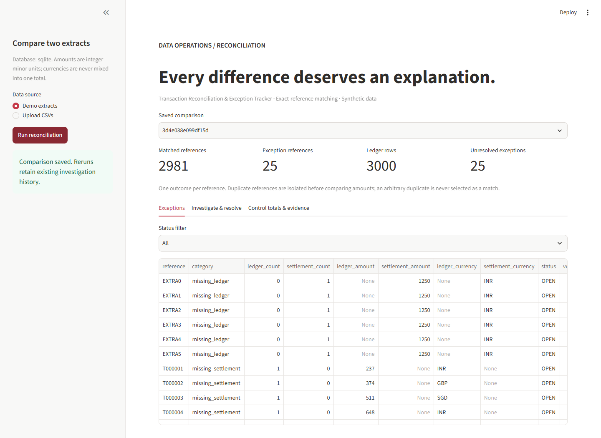

# Transaction Reconciliation & Exception Tracker

Compare two fictional transaction extracts, isolate discrepancies, and record investigation evidence without changing the original inputs.

## Run locally

Python **3.13** is the tested version. Clone this repository and run these commands from its root:

```bash
git clone https://github.com/Abhijay-Nagal/reconciliation-tracker.git
cd reconciliation-tracker
python -m venv .venv
```

Activate the environment with `source .venv/bin/activate` on macOS/Linux or `.\.venv\Scripts\Activate.ps1` in Windows PowerShell, then:

```bash
python -m pip install -r requirements.txt
python -m streamlit run app.py
```

The app uses bundled **synthetic data** and an automatically created local SQLite database by default. No API key, cloud account, or other project repository is needed. Open the localhost URL printed by Streamlit.

For the command-line demonstration and exports:

```bash
python reconcile.py
python reconcile.py --help
```

`DATABASE_URL` selects an existing PostgreSQL database instead of the SQLite default. Use a `postgresql+psycopg://` connection URL stored in your environment; do not commit credentials. The code creates its own tables. Both backends are covered by the test suite.



## Tests

```bash
python -m pytest tests --import-mode=importlib -q
```

Tests use temporary SQLite databases unless `TEST_DATABASE_URL` selects a dedicated disposable PostgreSQL test database. Backend fixtures rebuild this project's tables in that test database. Never use a production or valuable database for tests. The dashboard interaction test always uses a temporary SQLite database.

GitHub Actions runs the suite on Python 3.13 with SQLite and PostgreSQL. The workflow also checks dependencies and exercises the standalone CLI.

## Deploy

The application entry point is **`app.py`**, and dependencies are in **`requirements.txt`**. See [deployment instructions](docs/DEPLOYMENT.md) for Streamlit Community Cloud and database persistence. Publishing this source repository does not itself create a running web app.

## Architecture and matching contract

CSV validation -> immutable run snapshot -> SQL aggregation by reference -> union of reference keys -> left joins -> one classification per reference -> exception table -> transactional status/event updates.

`reference` must be globally unique **within each side of this comparison**. If a future source reuses references by market/date, extend the key to include those fields; do not fuzzy-match money. Files contain exactly `reference,amount_minor,currency`. Amounts are nonnegative 1-9 digit integer magnitudes. This simplified settlement extract has no purchase/refund direction; it compares magnitudes only. The catalog separately models purchase/refund reporting semantics.

Decision order:

1. Duplicate reference on either side: `duplicate_reference`.
2. No ledger row: `missing_ledger`.
3. No settlement row: `missing_settlement`.
4. Different currencies: `currency_mismatch`.
5. Different integer amounts: `amount_mismatch`.
6. Otherwise: matched.

The SQL uses grouped counts before joining, so duplicates cannot inflate matches through a many-to-many join. `MIN(amount)` and `MIN(currency)` are representative fields only when a reference is duplicated; drill into raw `rec_entries` to see all duplicate rows. One category per reference means a duplicate can hide additional amount/currency problems until investigated; this is an explicit prioritization choice.

## Demonstrated result

3,000 ledger rows versus 3,004 settlement rows -> 3,006 unique references -> **2,981 matches and 25 exceptions**:

- 5 missing from settlement;
- 6 missing from ledger;
- 7 amount differences;
- 4 currency differences;
- 3 duplicate settlement references.

Raw control totals include duplicates and are grouped by side AND currency. All supported currencies (INR, GBP, SGD) use hundredths. No cross-currency grand total or FX conversion is produced. This is a portfolio reconciliation, not a claim of regulatory compliance or fraud detection.

## Investigation workflow

`OPEN -> INVESTIGATING -> RESOLVED`; `INVESTIGATING -> OPEN` and `RESOLVED -> INVESTIGATING` are allowed. Reviewer and evidence note are mandatory. A version predicate in the database update prevents stale browser sessions from overwriting a newer state. The exception update and event insertion share one database transaction. Re-uploading identical bytes reuses the run and retains statuses/history. Different byte content produces a separate comparison; investigations do not automatically transfer.

The event log is append-only through application functions, not tamper-proof storage. Reviewers are typed labels with no authentication. Resolved means a reviewer recorded evidence; it does not mutate sources or prove that the discrepancy disappeared. Matching results remain the original comparison snapshot. Schema/amount failures reject the whole upload before inserts. Headers-only files are allowed to demonstrate a wholly missing side.

CSV downloads neutralize formula-like text in reviewer notes. The CLI writes `artifacts/summary.json` and `artifacts/exceptions.csv`. Tests cover duplicate joins, currencies, malformed files, empty sides, state transitions, stale updates, reruns and dashboard interactions.

See [the study guide](docs/STUDY_GUIDE.md).
